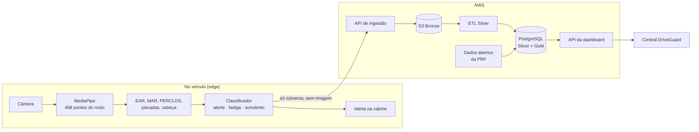

# DriveGuard

**Proteção inteligente em cada trajeto.** Detecção de sonolência em motoristas de caminhões e ônibus por visão computacional, com uma central que acompanha a frota em tempo real.

> TCC 2026 · *Análise comparativa de abordagens de visão computacional para detecção de sonolência em motoristas de caminhões e ônibus*

## O problema

- **1,19 milhão de mortes por ano** em acidentes de trânsito no mundo (OMS, 2023).
- Quem dorme **4 a 5 horas** antes de dirigir tem cerca de **o dobro** da chance de se envolver em um acidente (Sprajcer et al., 2023).
- A sonolência reduz justamente a percepção de que se está com sono: depender da autoavaliação do motorista não basta (Cai et al., 2021).
- Nas rodovias federais, a base aberta da PRF registra os acidentes com veículos pesados ligados ao sono, hora a hora e trecho a trecho.

## A solução

1. **No veículo:** a câmera mede abertura dos olhos (EAR), bocejos (MAR), tempo de olhos fechados (PERCLOS), piscadas e inclinação da cabeça. O modelo classifica o motorista em **alerta, fadiga ou sonolento** e o alerta toca na cabine, mesmo sem internet.
2. **Na nuvem:** só métricas numéricas e identificadores anonimizados sobem. Nenhuma imagem do rosto sai do veículo.
3. **Na central:** a dashboard mostra quem está em risco agora, os alertas aguardando resposta, a fadiga ao longo do turno, as rotas e horários críticos, o impacto estimado (ROI) e recomendações geradas por IA.

## Repositórios

| Repositório | O que tem |
|---|---|
| [**ML**](https://github.com/Drive-Guard/ML) | Extração de features (MediaPipe), modelos de classificação, detecção de piscadas e distração, modelo preditivo e o cliente que envia as leituras da câmera para a AWS |
| [**ETL**](https://github.com/Drive-Guard/ETL) | Download e tratamento dos dados abertos de acidentes da PRF |
| [**Infra**](https://github.com/Drive-Guard/Infra) | Toda a AWS em Terraform: VPC, API Gateway, Lambdas de ingestão e ETL, RDS PostgreSQL (arquitetura medallion), EC2, Cognito, simulador da frota e o script que sobe tudo com um clique |
| [**Backend**](https://github.com/Drive-Guard/Backend) | API da dashboard: Lambdas em TypeScript (Serverless Framework), relatórios em PDF/Excel e insights com IA |
| [**Site**](https://github.com/Drive-Guard/Site) | A dashboard da central: React + TypeScript |

## Arquitetura na AWS

## Equipe

Amanda Cupola Alves · Caetano Resende Domingues · Danilo Santos Alves Marques · Emily Ferreira · Raphael Klein de Almeida · Vinicius Bazan Cirello
